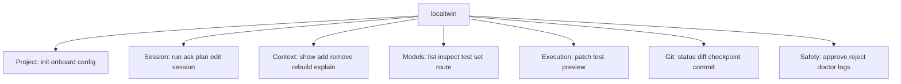
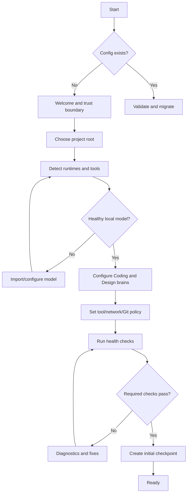
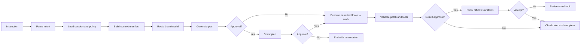
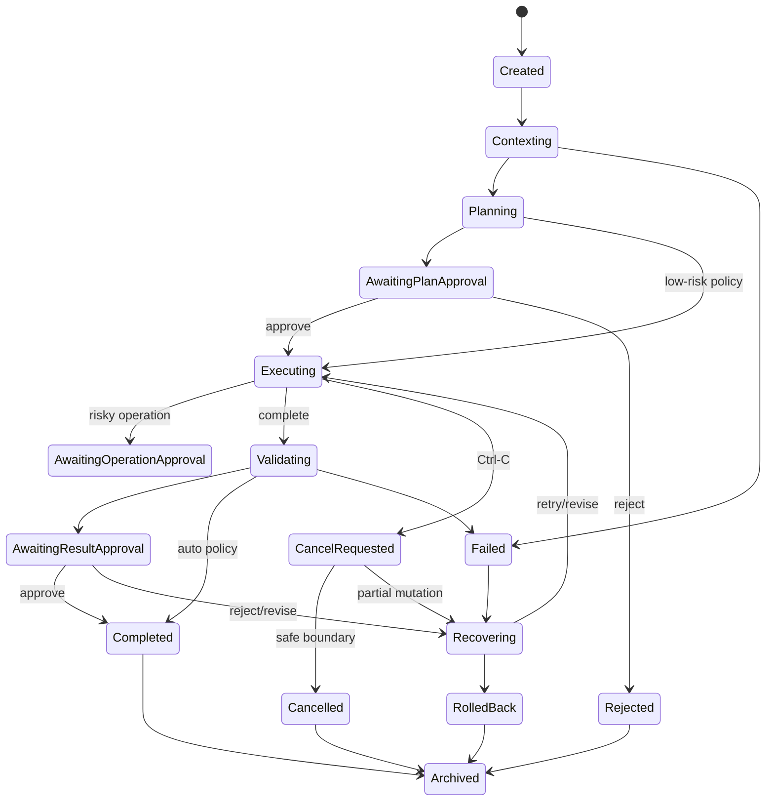
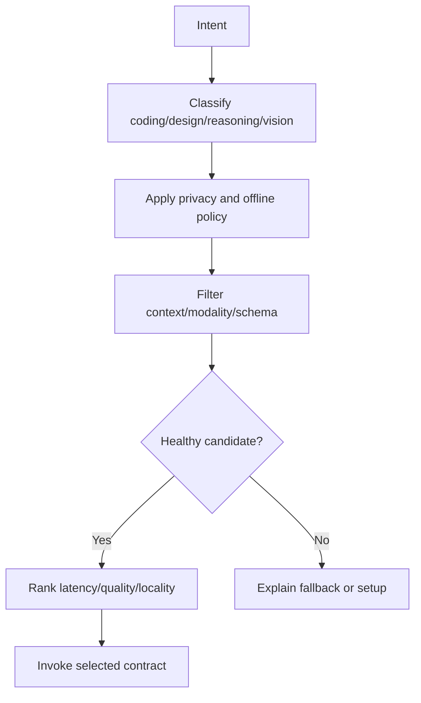

# LocalTwin CLI — Software App Flow Specification

**Primary interface:** Terminal-first, with interactive TTY, compact, plain, JSON, and CI modes  
**Core promise:** Turn a local repository and local model runtime into a controlled, inspectable coding and design workspace.

## 1. Interaction Model

There is no permanent graphical home screen. Navigation is command-based, while a task session provides the equivalent of a screen flow. Every interactive view exposes session ID, project root, branch/Git state, brain, model, profile, network posture, phase, and available actions.

Top-level navigation:



Operating modes:

| Mode | Behavior |
|---|---|
| Interactive | Rich TTY view, prompts, keybindings, streaming |
| Compact | Linear readable output for SSH/narrow terminals |
| Plain | No color or Unicode, copy/paste friendly |
| JSON | Versioned events/results for scripts and CI |
| Dry run | Computes context, plan, and intended operations only |

## 2. First-Run Onboarding



### O1 Welcome

```text
LOCAL TWIN — local coding and design workspace
Your files stay on this machine unless you explicitly allow a network tool.
Models propose; policy and you approve consequential actions.
[Enter] Continue  [S] Security details  [Q] Quit
```

### O2 Project root

Show resolved real path, Git root, branch, file count, detected languages/frameworks, and symlink warnings. Ask whether to use the directory; allow changing path.

### O3 Model discovery

List each endpoint, model alias, capabilities, context window, vision/tool support, health, and privacy class. Coding and Design assignments are separate even if they point to the same model.

### O4 Policy

Show reads, writes, shell, network, Git, preview, secrets, and install behavior. Profiles are selectable; all values are editable and saved only after confirmation.

### O5 Verification

Run project readability, Git capture, model response, schema validation, patch parser, test detection, preview detection, disk, permissions, and sandbox checks. Never claim ready if required model checks fail.

## 3. Session Start and Main Task Screen

`localtwin run TEXT` follows **instruction → intent → context → route → plan → approval → execute → validate → result → checkpoint**.



Persistent task screen:

```text
LOCAL TWIN · session s_01 · /repo · feature/settings
TASK  Add keyboard navigation to settings tabs
PHASE PLAN / APPROVAL REQUIRED
BRAIN coding   MODEL coder-local   NETWORK denied   CONTEXT 18.4k/32k

PROPOSED OPERATIONS
1. M src/Settings.tsx                 MEDIUM
2. A tests/settings.keyboard.test.ts LOW
3. RUN pnpm test -- settings.keyboard COMMAND

[a] approve [r] reject [d] diff [e] explain [c] context [t] tests [q] quit
```

## 4. Command-by-Command Flows

### `init`

Resolve path → detect Git/frameworks → propose `.localtwin/project.toml` and ignore file → display scope → confirm → write config → snapshot state → run doctor. `--dry-run` writes nothing.

### `onboard`

Re-run setup without replacing existing settings silently. Show a before/after config diff and require confirmation for policy changes.

### `ask`

Read-only by default. Parse question → retrieve context → show evidence manifest → route to Coding or Design Brain → return answer with citations, assumptions, uncertainty, and next actions. It cannot write or execute.

### `plan`

Read-only. Build context → generate structured plan → validate schema → show affected files, risks, tests, approval needs → optionally save Markdown/JSON.

### `edit`

Resolve requested scope → retrieve target files → generate operations → validate base hashes → render diff → approve per file/operation → atomically apply → optionally run formatter/tests → checkpoint.

### `patch`

`verify` checks schema, paths, hashes, conflicts, generated-file policy, and binary behavior. `show` displays diff. `apply` requires applicable approval and checkpoint. `reject` records reason without changing files.

### `preview`

Detect configured command → create tracked process group → bind loopback → health check → expose local URL → capture DOM/screenshot/console → run visual/accessibility inspection → stop by command or TTL. Network remains denied unless explicitly configured.

### `test`

Resolve declared command → show argv/cwd/environment redaction/timeout → approval if needed → run with process limits → stream output → record exit code/signal/duration/truncation → classify result.

### `context`

`show` displays included/excluded items and token cost. `add/remove` changes explicit scope. `rebuild` invalidates index. `explain` states why each item was ranked, summarized, or excluded.

### `model`

`list` shows aliases and capabilities. `inspect` shows endpoint class, context, quantization, health, and privacy. `test` performs a non-sensitive request. `set` changes routing. `route` explains candidate ranking.

### `session`

`list` filters by status/project/date/brain. `show` displays event timeline and artifacts. `resume` revalidates hashes/policy/models. `fork` creates a new session with selected context. `export` produces Markdown/JSON/redacted bundle. `archive` closes without deletion.

### `approve` / `reject`

Approval is operation-scoped. Display exact files, command, host, environment, risk, lifetime, and diff visibility. Bulk approval is allowed only for matching low-risk operations and records the filter.

### `git`

`status` captures worktree/index/untracked state. `diff` separates intended and unrelated changes. `checkpoint` creates local recoverable state. `commit` displays staged diff and message, creates checkpoint, then requires explicit approval. No force-push or history rewrite by default.

### `doctor`

Check config, migration, model, index, Git, permissions, disk, sandbox, preview, terminal, and cache. Each diagnostic includes status, evidence, impact, and remediation.

## 5. Screen Specifications

### S1 Idle
Project summary, active profile, brain/model aliases, network posture, last session, and examples. Actions: run, ask, plan, doctor, model, context.

### S2 Inspecting
Progress by phase: root detection, ignore rules, secret scan, indexing, retrieval, token budget. Provide cancel key and current item. Never show secret content.

### S3 Thinking
Show brain, model, elapsed time, context hash, streaming status, and cancel. If model has no token streaming, show phase text and elapsed time rather than a spinner only.

### S4 Plan
Show objective, assumptions, ordered steps, affected files, risks, tests, and required approvals. Actions: approve, reject, edit instruction, inspect context, save.

### S5 Diff/Proposal
Show unified diff, per-file risk, base hash, generated-file warnings, and unrelated dirty changes. Actions: select files, explain, approve, reject, refresh.

### S6 Approval
```text
APPROVAL REQUIRED · op-17 · RISK MEDIUM
M src/Settings.tsx +34 -8
A tests/settings.keyboard.test.ts +71
Checks: base hashes match; secrets excluded; checkpoint ready
[a] approve [r] reject [m] change scope [p] policy [d] diff
```

### S7 Executing
Show exact command or operation, cwd, policy, timeout, network, live output, and cancellation state. Distinguish proposed, started, completed, failed, killed, and partially completed.

### S8 Validating
Show each formatter, typecheck, unit test, preview, and accessibility check with exact scope and result. A model statement is never a validation result.

### S9 Conflict
Show expected/current hash, affected path, current diff, and options: refresh/regenerate, three-way merge proposal, manual edit, cancel. No silent overwrite.

### S10 Complete
Show changed files, checkpoints, tests, preview artifacts, remaining risks, model provenance, and next commands. Clearly label unverified claims.

### S11 Recovery
Show failure class, whether mutation occurred, preserved artifacts, cleanup status, and safe choices: retry, fallback with disclosure, revise, restore checkpoint, export, quit.

## 6. State Machines



### Approval state machine

`proposed → displayed → approved/rejected/expired → executing → completed/failed/cancelled`. Approval cannot be reused after scope, base hash, policy, branch, or model changes.

### Preview state machine

`requested → command_detected → starting → healthy → serving → capturing → stopped/expired/failed`; cleanup always attempts process-group termination and records survivors.

## 7. Model Routing and Brain Handoff



Design-to-code path: frame problem → create flow and states → user confirms/edit handoff → hash handoff → Coding Brain receives handoff plus repository context → plan maps components/data/tests → user approves patch. Unresolved questions remain visible and block unsafe assumptions when configured.

## 8. Context Flow

Hard excludes and secret rules run first. Then direct user files, symbols/imports, tests, routes, config, recent diff, design tokens, screenshots, and relevant history are ranked. The system reserves output and tool-result budget, summarizes low-ranked context, emits a manifest, and stores its hash. On resume or patch apply, changed hashes invalidate dependent results.

## 9. Decision Paths and Exceptions

- **No model:** stop with setup guidance; never use remote silently.
- **Model schema failure:** preserve raw response locally, reject it from execution, retry boundedly or show adapter error.
- **Context overflow:** summarize/drop by declared policy; disclose omitted files and offer explicit attachments.
- **Prompt injection:** classify repository text as untrusted data; do not obey instructions that request secrets, network, policy changes, or unrelated actions.
- **Dirty tree:** show unrelated changes; isolate or ask for scope.
- **Stale patch:** block application; refresh or propose merge.
- **Command timeout:** terminate process group, preserve output, verify workspace, offer retry with a changed timeout.
- **Secret output:** redact before model exposure and persistence; warn about local process output.
- **Partial patch:** restore atomic checkpoint where possible; otherwise list applied/unapplied operations and offer rollback.
- **No Git:** permit file operations with reduced rollback; create file snapshots if configured.
- **Merge conflict:** do not silently resolve; show conflict markers and produce a read-only explanation.
- **Offline:** local models/tools continue; registry, remote docs, package install, and cloud fallback are blocked with explicit reasons.
- **Concurrent LocalTwin process:** lock mutable resources or use transaction-safe IDs; never corrupt index/session data.
- **Cancellation during destructive command:** report uncertain termination and require workspace verification.
- **Terminal too narrow:** switch from panes to linear sections; never hide approval.

## 10. Accessibility and Terminal Resilience

Support `--plain`, `--ascii`, `--screen-reader`, `--json`, `NO_COLOR`, contrast themes, narrow terminals, SSH, redirected output, bracketed paste, and Unicode paths. Color is supplemental; statuses use `PASS`, `WARN`, `BLOCKED`, `RISK: HIGH`. Spinners are accompanied by phase, elapsed time, and current action. Ctrl-C is safe-boundary cancellation; a second interrupt may force-stop with warning.

## 11. End-to-End Scenarios

### Feature implementation

`run` detects settings route and tests → Coding Brain proposes keyboard navigation → user reviews two edits and one test → checkpoint → patch apply → focused tests/typecheck → preview screenshot → final diff and evidence.

### Design review

`preview start` → screenshot/DOM/token capture → Design Brain returns severity/evidence/recommendation items → user selects one → structured handoff or patch plan → Coding Brain maps it to components and tests.

### Failed test recovery

Validation shows failure and output → session enters recovery → user chooses revise → Coding Brain receives current diff, failure artifact, and affected files → new proposal requires normal approval; original checkpoint remains available.

### CI review

`plan --json --diff origin/main...HEAD` outputs versioned findings, evidence, risk, model trace, required approvals, and exit code. Without explicit CI mutation policy, no write or command action occurs.

## 12. Acceptance Checklist

A build is accepted when every command has interactive and JSON behavior; every consequential action has an approval path; session resume invalidates stale state; model routing never violates offline/privacy policy; context inclusion is explainable; patches are hash-checked; checkpoints restore; tests report exact commands; previews clean up; secrets are excluded/redacted; narrow/plain/screen-reader modes work; and all failure classes lead to a safe next action.
