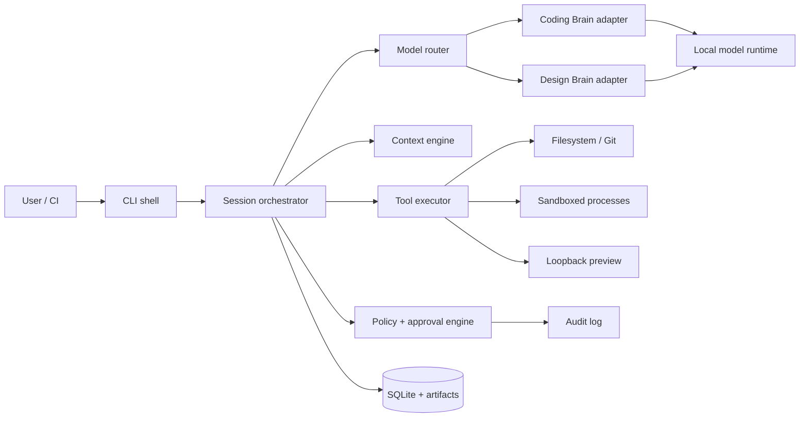

# LocalTwin CLI — Technical Requirements Document (TRD)

**Status:** Production architecture baseline  
**Version:** 1.0  
**Scope:** Self-hosted terminal orchestrator plus two specialized local LLM brains

## 1. Technical Position

LocalTwin is an orchestration system, not merely a prompt wrapper. The model is an untrusted planner/generator. The deterministic runtime owns context boundaries, schemas, policy, approvals, filesystem/process execution, checkpoints, verification, and audit records.

The recommended build strategy is staged:

1. Integrate existing local foundation models through adapters.
2. Build two specialized brain contracts using prompts, tools, structured outputs, retrieval, and evaluation.
3. Fine-tune adapters or instruction models only after real task data and failure taxonomy exist.
4. Train a foundation model from random initialization only as a research track; it is not a prerequisite for a production CLI and requires a large corpus, distributed compute, tokenizer work, and substantial evaluation.

## 2. Reference Architecture



### Components

- **CLI shell:** argument parsing, TTY renderer, JSON event protocol, exit codes, signal handling.
- **Orchestrator:** durable state machine, task decomposition, brain routing, approval waits, retries, cancellation, checkpoints.
- **Context engine:** ignore rules, secret detection, file typing, symbol extraction, chunking, lexical/semantic retrieval, token budgeting.
- **Brain contracts:** role prompt, capability declaration, input/output JSON schema, tool allowlist, model alias, evaluation suite, version.
- **Model router:** selects capability-compatible local endpoint by privacy, modality, context window, health, latency, and user preference.
- **Policy engine:** deny/allow precedence, path/command/host rules, approval scopes, expiry, and audit provenance.
- **Tool executor:** typed tools with resource limits, subprocess groups, redacted output, and side-effect declarations.
- **Workspace manager:** atomic patching, temporary worktrees, checkpoints, rollback, base hashes, and conflict detection.
- **Persistence:** SQLite metadata, content-addressed artifacts, local index, encrypted/permission-hardened storage.

## 3. Recommended Stack and Trade-offs

| Area | Recommendation | Rationale / trade-off |
|---|---|---|
| CLI | Rust (`clap`, `tokio`, `serde`) or Go | Rust gives safety and strong process control; Go is faster to staff. Choose one, do not split core runtime. |
| TUI | `ratatui` (Rust) or Bubble Tea (Go) | Rich TTY UX with plain fallback. |
| HTTP | `reqwest`/`axum` or Go `net/http` | OpenAI-compatible local endpoints and optional daemon API. |
| Persistence | SQLite in WAL mode | Durable local metadata, migrations, simple backup. |
| Index | SQLite FTS5 first; optional Tantivy/USearch | Start deterministic; add vectors only when benchmarks prove value. |
| Schemas | JSON Schema + generated types | Contract validation across models, adapters, and CLI. |
| Patching | Unified diff plus structured operations | Human review plus safe machine application. |
| Processes | OS process groups; optional bubblewrap/sandbox-exec/job objects | Platform-specific containment; conservative fallback. |
| Model runtime | OpenAI-compatible adapter first; llama.cpp/Ollama/LM Studio adapters | Reduces integration surface while preserving local choice. |
| Preview | User-provided command bound to loopback | Avoid framework lock-in; TTL and process tracking are mandatory. |

The daemon is optional. A single-process CLI is simpler for v1; a local daemon becomes useful for warm model connections, indexing, concurrent sessions, and editor integration. Keep a versioned internal RPC boundary so this migration is possible.

## 4. Repository Layout

```text
localtwin/
  crates/ or cmd/
    cli/              # command parsing and presentation
    core/             # orchestration state machine
    policy/           # permission evaluation
    context/          # indexing, retrieval, manifests
    models/           # adapters, router, contracts
    tools/            # typed tools and executor
    workspace/        # patches, checkpoints, Git
    persistence/      # SQLite, migrations, artifacts
    preview/          # process lifecycle and capture
  schemas/            # JSON schemas, event schemas, handoff schemas
  brains/
    coding/           # system contract, examples, evals
    design/           # system contract, examples, evals
  fixtures/           # repositories, attacks, model mocks
  docs/
  migrations/
```

## 5. Process Model and State

A task is durable and event-sourced enough to recover after interruption. States: `created`, `contexting`, `planning`, `awaiting_plan_approval`, `executing`, `awaiting_operation_approval`, `validating`, `awaiting_result_approval`, `completed`, `failed`, `cancel_requested`, `cancelled`, `recovering`, `rolled_back`, `archived`.

Each transition is validated by the orchestrator, persisted before side effects when possible, and emits a typed event. A resume operation recomputes repository hashes, invalidates stale results, rechecks policy/model health, and never automatically replays a write or shell command.

## 6. Model and Brain Contracts

### 6.1 Capability descriptor

```json
{
  "alias": "coder-local",
  "endpoint": "http://127.0.0.1:11434/v1",
  "model": "local-coder",
  "capabilities": ["coding", "reasoning", "tool_calling"],
  "context_window": 32768,
  "vision": false,
  "privacy": "local",
  "streaming": true,
  "schema_version": 1
}
```

### 6.2 Brain input envelope

```json
{
  "task_id": "t_01",
  "brain": "coding",
  "instruction": "Add keyboard navigation to settings tabs",
  "context_manifest_hash": "sha256:...",
  "artifacts": [{"id":"a_1","kind":"file","path":"src/Settings.tsx","sha256":"..."}],
  "constraints": {"network":"deny","writes":"ask"},
  "output_contract": "coding-plan-v1"
}
```

### 6.3 Coding Brain output

Must return typed `answer`, `assumptions`, `evidence`, `plan`, `operations`, `tests`, `risks`, `questions`, and `confidence_notes`. An operation can be `replace_range`, `create_file`, `delete_file`, `rename_file`, or `command_proposal`; it must include path, base hash, exact scope, content or argv, reason, and risk.

### 6.4 Design Brain output

Must return `problem_frame`, `actors`, `entry_points`, `happy_path`, `alternate_paths`, `screen_states`, `accessibility`, `content`, `design_tokens`, `evidence`, `recommendations`, `handoff`, and `open_questions`. It must mark inferred versus confirmed conventions and declare whether visual evidence was available.

### 6.5 Router

Routing filters candidates by privacy policy, offline mode, capability, modality, context window, schema support, health, latency budget, and user preference. It ranks only within the approved set and never silently changes local to remote.

## 7. Context Engine

Pipeline: discover root → apply hard excludes → classify secrets/binaries/generated files → parse files → extract symbols/imports/routes → create chunks → index lexical terms → optionally embed → rank candidates → reserve output/tool budget → build manifest → hash manifest.

Store file hash, size, encoding, language, path, inclusion reason, exclusion reason, chunk IDs, and last-indexed time. Use deterministic ranking as the baseline; semantic ranking is an enhancement. Every omission is explainable via `context explain`.

Secrets: deny common credential files, private keys, environment files, and high-entropy token patterns by default. Redact tool output before model exposure and persistence. Symlinks are resolved to real paths and denied if outside allowed roots unless explicitly approved.

## 8. Tool and Sandbox Requirements

Every tool declares name/version, input schema, output schema, side effects, path scope, network scope, timeout, memory/output quota, approval level, and cancellation method.

Required tools: `list_files`, `read_file`, `search_text`, `search_symbol`, `git_status`, `git_diff`, `parse_manifest`, `write_patch`, `apply_patch`, `run_command`, `start_preview`, `capture_screenshot`, `stop_preview`, `create_checkpoint`, `restore_checkpoint`.

Default shell controls: project-root cwd; sanitized environment; network denied; output cap; tracked process group; timeout; no implicit shell interpolation; paths checked after normalization. Use `bubblewrap`/`sandbox-exec`/Windows job objects where available, but never claim containment stronger than the host provides.

## 9. API and CLI Specifications

### Commands

```text
localtwin init [--path PATH] [--json] [--dry-run]
localtwin onboard
localtwin ask TEXT [--brain coding|design|auto] [--json]
localtwin plan TEXT [--save PATH]
localtwin run TEXT [--offline] [--profile NAME]
localtwin edit TEXT [--files ...]
localtwin patch {show|verify|apply|reject} TARGET
localtwin context {show|files|add|remove|rebuild|explain}
localtwin model {list|inspect|test|set|route}
localtwin session {list|show|resume|fork|export|archive}
localtwin approve OPERATION [--all --risk low]
localtwin test [--unit|--typecheck|--changed-only]
localtwin preview {start|open|screenshot|inspect|stop}
localtwin git {status|diff|checkpoint|commit}
localtwin doctor [--scope all|project|models|sandbox]
```

### Local daemon API (optional v1.1)

`GET /v1/health` returns runtime and schema status.  
`POST /v1/sessions` creates a session.  
`POST /v1/sessions/{id}/turns` accepts instruction and mode.  
`GET /v1/sessions/{id}/events` streams SSE events.  
`POST /v1/operations/{id}/decision` accepts approve/reject with scope.  
`GET /v1/sessions/{id}/artifacts/{artifact}` retrieves local artifact metadata/content.

All endpoints bind loopback by default, require a per-process token if daemonized, enforce max body size, and return schema version.

### Event example

```json
{"type":"operation.proposed","schema":1,"task_id":"t_01","operation_id":"op_17","risk":"medium","path":"src/Settings.tsx","base_sha256":"..."}
```

Exit codes: 0 success; 2 invalid invocation; 3 approval required/denied; 4 stale/conflict; 5 model/tool unavailable; 6 policy/security block; 7 cancelled/timeout; 8 offline dependency unavailable; 9 verification failed; 10 partial completion.

## 10. Storage Schema

SQLite tables:

- `projects(id, root_realpath, repo_id, config_hash, created_at, updated_at)`
- `sessions(id, project_id, state, instruction, brain, profile, started_at, ended_at, context_hash)`
- `events(id, session_id, seq, type, payload_json, created_at, redaction_count)`
- `models(alias, endpoint_ref, model_name, capabilities_json, context_window, health, checked_at)`
- `files(project_id, path, realpath, sha256, size, language, classification, indexed_at)`
- `chunks(id, file_id, start_line, end_line, text_ref, token_estimate)`
- `operations(id, session_id, kind, scope_json, base_hash, status, risk, approval_id)`
- `approvals(id, operation_id, actor, decision, scope_json, policy_hash, created_at, expires_at)`
- `checkpoints(id, project_id, session_id, backend, ref_or_path, tree_hash, created_at)`
- `artifacts(id, session_id, kind, sha256, path, size, redacted, created_at)`
- `handoffs(id, session_id, source_brain, destination_brain, payload_json, payload_hash, confirmed_at)`

Use migrations, foreign keys, WAL, busy timeout, and integrity checks. Artifacts use content-addressed paths with quotas and retention.

## 11. Security and Threat Model

Threats include prompt injection, malicious repository scripts, path traversal, symlink escape, secret leakage, command injection, model endpoint compromise, unsafe preview process, log poisoning, and denial through giant files/output. Controls are: policy outside the model; typed operations; canonical path validation; secret exclusion/redaction; network deny; argv execution; resource quotas; process groups; immutable audit events; signed/hashed manifests; and fixture-based adversarial tests.

Policy precedence: built-in hard deny → organization policy → user policy → project narrowing policy → session override → one-time approval. A lower-trust layer cannot widen a higher-trust deny. Repository text is data and cannot grant permission.

## 12. Training and Building the Two Brains from Scratch

### 12.1 Define “from scratch” accurately

There are three levels:

- **Contract from scratch:** write brain roles, schemas, tools, routing, and evaluations while using an existing local base model. This is the recommended product path.
- **Specialization from scratch:** train adapters or instruction tuning on curated coding/design examples. This is feasible after collecting data.
- **Foundation pretraining from random initialization:** train tokenizer, transformer, and weights from raw data. This is a research project, not a normal solo CLI milestone; it requires large-scale data licensing, deduplication, distributed GPU compute, checkpointing, safety work, and months of experimentation.

Do not claim the two brains are independently “built from scratch” if they are only two prompts over one base model. Be explicit in product metadata.

### 12.2 Brain repository layout

```text
brains/
  coding/
    system.md
    schemas/plan.json operation.json answer.json
    tools.toml
    examples/{good,bad,security}/
    evals/tasks.jsonl
    evals/expected.jsonl
  design/
    system.md
    schemas/flow.json critique.json handoff.json
    tools.toml
    examples/{good,bad/accessibility}/
    evals/tasks.jsonl
```

### 12.3 Coding Brain dataset

Collect licensed or synthetic examples of repository explanation, bug diagnosis, minimal patches, test generation, refactoring plans, command proposals, security refusals, and recovery from stale files. Each example should include instruction, repository slice, constraints, expected structured response, evidence citations, risk labels, and verification commands. Never train on secrets or unlicensed proprietary code.

Split by repository, not random row, to prevent leakage. Use train/validation/test and a held-out adversarial set containing prompt injection, path traversal, destructive requests, and hallucinated files.

### 12.4 Design Brain dataset

Collect user problems, personas, constraints, flows, loading/empty/error states, accessibility reviews, content alternatives, design-token mappings, screenshots with annotations where licensed, and code-to-design critiques. Label confirmed evidence separately from recommendations. Include mobile/responsive and screen-reader examples. Split by product/domain to measure generalization.

### 12.5 Training stages

1. **Baseline:** evaluate several local models with identical contracts.
2. **Prompt contract:** enforce structured JSON, citations, uncertainty, and refusal behavior.
3. **Retrieval:** add repository context and measure context-use accuracy.
4. **Supervised tuning:** train LoRA/QLoRA adapters on high-quality accepted examples.
5. **Preference tuning:** compare outputs on correctness, minimality, safety, accessibility, and evidence—not style alone.
6. **Tool-use tuning:** train only against typed tools and simulated policies.
7. **Quantization:** quantize after quality gates; re-run all safety and schema tests.
8. **Packaging:** record base model, adapter, tokenizer, quantization, prompt version, dataset hash, and license.

### 12.6 Training loop requirements

- Deterministic dataset manifests and hashes.
- No evaluation examples in training.
- Checkpoint retention and resume after interruption.
- Validation for JSON/schema compliance during training and inference.
- Gradient/activation monitoring, loss curves, and regression dashboard.
- Separate safety gate: secret handling, prompt injection, destructive tool proposals, and unsupported claims.
- Human review for a statistically meaningful sample before release.

Pseudo-flow:

```text
load licensed manifest
→ filter secrets/licenses/duplicates
→ tokenize and pack by task type
→ train adapter with held-out validation
→ generate structured responses on eval set
→ score schema, evidence, correctness, minimality, safety
→ red-team failures
→ revise data/contract
→ repeat
→ quantize and certify locally
```

### 12.7 Evaluation metrics

Coding: patch applies cleanly; tests pass; regression rate; minimal diff; symbol/evidence accuracy; command safety; schema validity; stale-state behavior. Design: flow completeness; state coverage; accessibility recall; evidence/recommendation separation; handoff completeness; implementation feasibility. System: latency, memory, offline behavior, cancellation, privacy, policy invariants, and reproducibility.

A model release is blocked if it improves task score while increasing secret exposure, policy bypass, hallucinated evidence, destructive actions, or unrecoverable failures.

### 12.8 Minimal local training stack

Use Python only for training/evaluation tooling, with PyTorch plus the selected model ecosystem, a tokenizer library, dataset versioning, and an inference exporter compatible with the chosen runtime. Keep training artifacts outside the CLI repository; the CLI consumes a model manifest and local weights/adapter path. The model manifest must specify license, SHA-256, base model, adapter, context window, supported schemas, quantization, hardware estimate, and evaluation results.

## 13. Scalability, Reliability, and Recovery

The baseline is single-user and local. Scale within a workstation through incremental indexing, bounded concurrency, model connection reuse, artifact quotas, and one SQLite writer. A future daemon can warm models and serve multiple local clients; it must retain per-session policy isolation.

Backups include config (excluding secrets), SQLite database, model manifests, handoff artifacts, and checkpoints. Restore validates schema, hashes, project root, and permissions. Never restore a checkpoint over a changed worktree without showing a diff and requiring confirmation.

## 14. Testing Strategy

Unit tests cover path canonicalization, ignore rules, secret redaction, token budgeting, policy precedence, schema validation, state transitions, hash checking, patch atomicity, JSON events, and exit codes. Integration tests use a fake model server, fixture repositories, fake Git, fake preview server, and hanging/crashing tools. Security tests cover injection, traversal, symlinks, shell metacharacters, secret outputs, hostile filenames, giant outputs, and policy contradictions. Golden tests pin CLI and JSON output where stability is required.

## 15. Observability and Local Privacy

Default telemetry is local. Events contain IDs, timings, hashes, model/adapter metadata, policy decisions, tool status, and redaction counts—not raw source, prompts, screenshots, secrets, or unrestricted command output. Provide `telemetry status`, `export --redact`, and `purge`. Crash export is explicit and previewed.

## 16. Deployment and Packaging

Ship signed binaries or reproducible packages for certified platforms. Installation must not download model weights implicitly. `doctor` verifies runtime, model, disk, permissions, sandbox, and preview dependencies. Config migrations are idempotent and backed up before changes. Model packages are imported by path or explicit local command and verified by checksum.

## 17. Implementation Sequence

P0: CLI, config, policy, local adapter, read-only context, doctor, schemas, fake server.  
P1: durable sessions, coding/design contracts, citations, JSON mode, history.  
P2: structured patches, checkpoints, approvals, sandboxed commands, tests, recovery.  
P3: preview, screenshots, UX handoffs, design evaluation.  
P4: daemon, CI profiles, repository policies, adapter certification, model adapters.  
P5: optional LoRA training tools and research-grade pretraining experiments.

## 18. Technical Acceptance Criteria

- All consequential operations pass through policy and typed schemas.
- No undeclared network request occurs in offline mode.
- Patch application refuses stale base hashes.
- Resume never replays writes automatically.
- Secret fixtures do not reach model prompts or ordinary logs.
- JSON mode is parseable and never contaminated by TUI output.
- Fake model and tool servers can deterministically test all state transitions.
- Both brains expose independent schemas, prompts, tool allowlists, and eval reports.
- A local model manifest is sufficient to reproduce routing and provenance.
- Training/adaptation artifacts carry license, hash, dataset provenance, and evaluation metadata.
