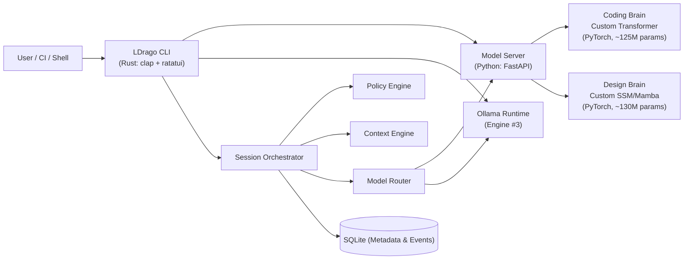

# LDrago CLI — Design Specification

**Status:** Approved Architecture Baseline  
**Date:** 2026-11-07  
**Tool Name:** LDrago  
**Primary Interface:** Terminal (CLI) — Interactive, Compact, Plain, and JSON modes  
**Core Innovation:** Native multi-engine orchestration supporting two custom neural architectures built entirely from scratch in PyTorch alongside an Ollama local model runtime.

---

## 1. System Overview

LDrago is a modular, production-ready AI CLI tool designed for software engineering and UX/system design. It provides a human-controlled orchestration layer around three AI engines:

1. **Coding Brain (Custom Neural Architecture #1):** A GPT-style decoder-only Transformer with Grouped-Query Attention (GQA), Rotary Positional Embeddings (RoPE), RMSNorm, and SwiGLU feed-forward networks, built natively from scratch in PyTorch.
2. **Design Brain (Custom Neural Architecture #2):** A State-Space Model (SSM / Mamba-style) with input-dependent selective scan, 1D causal depthwise convolution, and gated outputs, built natively from scratch in PyTorch.
3. **Local Runtime Model (Engine #3):** A local model runtime adapter connecting to Ollama for production-capable workflows (software engineering, system design, UI/UX prototyping).

### Zero External Foundation Dependency Guarantee
Both custom neural architectures are implemented without third-party LLM foundation weights or APIs. Tokenization is handled by custom-trained Byte-Pair Encoding (BPE) tokenizers written from first principles. Weights are initialized randomly and trained via custom PyTorch training loops.

---

## 2. System Architecture



---

## 3. Tech Stack Selection and Justification

| Layer | Technology | Justification |
|---|---|---|
| **CLI Runtime** | Rust 2024 Edition (`clap`, `tokio`, `serde`, `ratatui`) | Sub-second startup, memory safety, single static binary, rich terminal TUI with plain/JSON fallbacks, non-blocking async process management. |
| **Model Server & NN Framework** | Python 3.11/3.12, PyTorch, FastAPI, Uvicorn | Pure PyTorch implementation for tensor algebra, selective scan recurrence, and training/inference execution; lightweight asynchronous HTTP/SSE server. |
| **Local Foundation Runtime** | Ollama API client (`reqwest`) | Standardized OpenAI-compatible and native Ollama HTTP interface for community GGUF models. |
| **Configuration** | `figment` + TOML | Layered configuration: CLI flags > Env vars > Project TOML > User TOML > Default fallbacks. |
| **Persistence** | SQLite with WAL mode (`rusqlite`) | Zero-configuration, ACID-compliant local event sourcing, session recovery, and context manifests. |
| **Testing** | `cargo test` (Rust) & `pytest` (Python) | Unit tests, tensor shape assertions, round-trip tokenization tests, and mock HTTP integration tests. |

---

## 4. Custom Neural Architectures

### 4.1 Architecture #1: LDrago-Coder (Transformer)
- **Attention Mechanism:** Grouped-Query Attention (GQA) with causal triangular masking and key-value caching during inference.
- **Positional Encoding:** Rotary Positional Embeddings (RoPE) applied to Q and K representations.
- **Normalization:** Pre-RMSNorm across transformer layers.
- **Feed-Forward:** SwiGLU activation with gated dual linear projections.
- **Hyperparameters:**
  - Micro (CPU Testing): `d_model=128`, `n_layers=4`, `n_heads=4`, `n_kv_heads=2`, `d_ff=512`, `vocab_size=8192` (~1.5M params).
  - Starter: `d_model=768`, `n_layers=12`, `n_heads=12`, `n_kv_heads=4`, `d_ff=3072`, `vocab_size=32000` (~125M params).
  - Scaled: `d_model=1024`, `n_layers=24`, `n_heads=16`, `n_kv_heads=4`, `d_ff=4096`, `vocab_size=32000` (~350M params).

### 4.2 Architecture #2: LDrago-Designer (State-Space Model / Mamba)
- **Recurrence Mechanism:** Selective Scan algorithm with input-dependent `B`, `C`, and `Δ` projections.
- **Local Context:** 1D causal depthwise convolution (`kernel_size=4`) with SiLU activation.
- **Discretization:** Zero-order hold (ZOH) mapping: $\bar{A} = \exp(\Delta A)$, $\bar{B} = (\Delta A)^{-1}(\exp(\Delta A) - I) \cdot \Delta B$.
- **Gating:** Output modulated by element-wise multiplication with SiLU projection of input gate branch `z`.
- **Hyperparameters:**
  - Micro (CPU Testing): `d_model=128`, `n_layers=4`, `d_state=8`, `d_conv=4`, `expand=2`, `dt_rank=8` (~1.5M params).
  - Starter: `d_model=768`, `n_layers=24`, `d_state=16`, `d_conv=4`, `expand=2`, `dt_rank=48` (~130M params).
  - Scaled: `d_model=1024`, `n_layers=48`, `d_state=16`, `d_conv=4`, `expand=2`, `dt_rank=64` (~370M params).

### 4.3 Custom Tokenizer (BPE from Scratch)
- Implemented in pure Python without `tiktoken` or `tokenizers`.
- Byte-level base vocabulary (256 base bytes + special tokens `<PAD>`, `<BOS>`, `<EOS>`, `<UNK>`).
- Coder vocabulary includes domain tokens (`<CODE>`, `<ENDCODE>`, `<FILE>`, `<ENDFILE>`).
- Designer vocabulary includes domain tokens (`<FLOW>`, `<STATE>`, `<HANDOFF>`, `<CRITIQUE>`).
- Full binary serialization (`.bpe` vocab + merge rules).

---

## 5. Model Routing and Seamless Switching

1. **Model-Agnostic Conversation State:** Dialogue history is maintained in the Rust CLI as a sequential vector of turns:
   ```rust
   pub struct Turn {
       pub role: Role,
       pub content: String,
       pub tool_calls: Vec<ToolCall>,
       pub timestamp: DateTime<Utc>,
   }
   ```
2. **Context Preservation:** Switching models preserves message history, system instructions, and repository context manifests.
3. **Explicit User Gate:** Mid-session model switching requires explicit human approval in interactive mode and provenance logging in the event store.
4. **Fallback Circuit:** If custom neural brain services are unreachable or unconfigured, the router falls back to Ollama with clear status disclosure (`FALLBACK_ACTIVE`).

---

## 6. Safety, Policy, and Execution Controls

- **Deterministic Core:** Models are treated as untrusted generators. No filesystem mutation or shell execution occurs without policy evaluation.
- **Security Profiles:**
  - `Safe`: Read-only, no commands or modifications.
  - `Balanced`: Read and plan automated; writes and commands require approval.
  - `Explicit`: Every action and tool call requires confirmation.
  - `Offline`: Disables all remote network interfaces unconditionally.
- **Auditing:** Every operation, model prediction, and approval decision is written to SQLite WAL tables.
